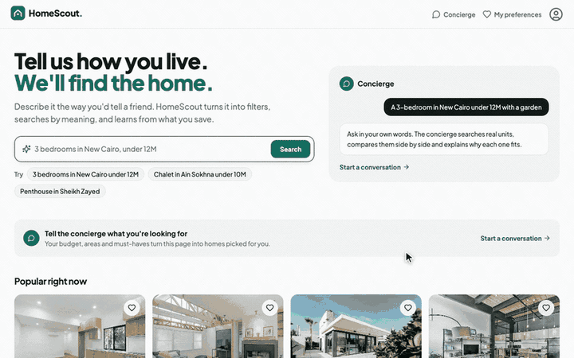
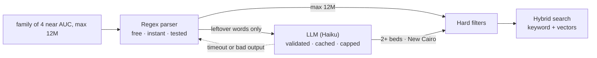
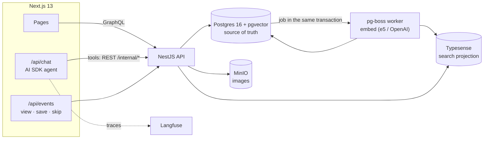

<div align="center">


# HomeScout AI

**An experiment in where an LLM belongs in search.**<br/>
Homes in Egypt are the test case.

[](https://github.com/Amrabrazek/homescout-ai/actions/workflows/ci.yml)
[](LICENSE)




</div>

Type "family of 4 near AUC, max 12M" or "3 owad fel tagamo3 ta7t 15 mil" and HomeScout turns it into real filters,
shows what it understood, and searches by meaning for the rest.



The rule: code does what code can do, and the LLM only gets the words code couldn't parse. Every claim below is measured.

## Search, measured

| Check | Result |
|---|---|
| Query parsing, regex only | 17/30 queries fully right |
| Query parsing, regex + LLM on the leftovers | 30/30 fully right · p50 2.3 s, p95 3.5 s (only when regex leaves words) |
| Semantic ranking, local e5 embeddings | 68% relevant in top 10 vs 37% for random order |

Full report, including where embeddings lost: [docs/evals/search.md](docs/evals/search.md) (`npm run eval`).

## What it does

| Feature | How it works |
|---|---|
| **Free-text search** | A regex parser turns "3 bedrooms in New Cairo under 12M" into hard filters, and the UI shows what it understood. An LLM handles only the words regex missed (Arabic, "family of 5", landmarks). That path is behind a flag, validated against the schema, cached and capped, and falls back to regex. |
| **Hybrid search** | Typo-tolerant keyword search plus vector search in Typesense. The listing, the concierge and the feed all share one filter builder. |
| **Similar units** | Filter by type, region and price band, then cosine top 30 from pgvector, then a weighted rerank on price, size, bedrooms and location, with at most 2 per project. Every result carries its reasons. |
| **Buyer profile** | An anonymous cookie, stated preferences, and views, saves and skips. A time-decayed taste vector is built from the embeddings of units the buyer engaged with. |
| **Concierge agent** | Vercel AI SDK with tools that call typed NestJS endpoints (`search_units`, `compare_units`, `find_similar`, `update_preferences`…). Tool results render as UI cards, and the model writes only the "why it fits". Traced in Langfuse. |
| **"Why it fits you"** | Deterministic checks of each unit against the buyer's stated preferences. It shows misses too, so nothing shown to the buyer is guessed. |
| **"For you" feed** | Ranks units that meet the buyer's preferences by their taste vector, with a penalty for units like ones they skipped. |
| **Evals** | `npm run eval` scores parsing, ranking, the feed and similar units against fixed fixtures; agent evals are in progress. |

## Architecture



## Engineering decisions

- **Postgres is the single source of truth.** Typesense is a projection that can be rebuilt at any time
  (`npm run reindex`), so the search index can never become the only copy of anything.
- **Sync through a transactional queue.** Every unit write enqueues a pg-boss job in the same transaction. A
  worker re-embeds the unit only if its text changed, then upserts Typesense, retrying with backoff. Search
  never sees half-written data.
- **Deterministic first, LLM second.** Regex parsing is free, fast and testable. The LLM is an optional
  fallback with strict output validation, a daily call cap and a timeout.
- **Pluggable embeddings.** `EMBEDDING_MODEL` switches between a free local model (`e5-small`, runs in Node)
  and OpenAI. Vectors are stored per model, so models can be compared side by side.
- **Model-agnostic agent.** `LLM_PROVIDER` / `LLM_MODEL` pick the model. Tools are plain REST endpoints with
  their own tests.

The full roadmap and decision log live in [issue #12](https://github.com/Amrabrazek/homescout-ai/issues/12).

## Quick start

Requirements: Docker with Docker Compose.

```bash
git clone https://github.com/Amrabrazek/homescout-ai.git homescout-ai
cd homescout-ai
docker compose up --build
```

On first start the backend applies database migrations, seeds sample data, and indexes it into Typesense.
Then open:

- App: http://localhost:3000
- GraphQL playground: http://localhost:3001/graphql
- MinIO console: http://localhost:9001 (user `homescout`, password `homescout-secret`)

Every setting has a working local default. To override one, copy `.env.example` to `.env` and edit it.

**Reset everything** (database, search index, images):

```bash
docker compose down -v
```

<details>
<summary><b>Local development (without Docker for the apps)</b></summary>


Run the infrastructure in Docker and the apps on your machine:

```bash
docker compose up postgres typesense minio minio-init

# backend
cd backend
cp .env.example .env
npm install
npm run db:seed              # apply migrations + seed if empty
npm run start:dev            # API + sync worker; embeds and indexes new units
npm run reindex              # (new terminal, first run) enqueue every unit for embedding + indexing

# frontend (new terminal)
cd frontend
cp .env.example .env         # set ANTHROPIC_API_KEY to use the concierge chat
npm install
npm run dev
```

### Useful scripts

| Where    | Command                       | What it does                                  |
| -------- | ----------------------------- | --------------------------------------------- |
| backend  | `npm run db:migrate`          | Apply pending migrations                      |
| backend  | `npm run db:migrate:revert`   | Revert the last migration                     |
| backend  | `npm run db:seed`             | Migrate, then seed sample data if DB is empty |
| backend  | `npm run db:seed -- --reset`  | Replace all data with fresh sample data       |
| backend  | `npm run reindex`             | Enqueue every unit: re-embed if changed, rebuild the Typesense index |
| backend  | `npm run lint` / `typecheck`  | Static checks                                 |
| backend  | `npm test` / `test:e2e`       | Unit tests / API tests                        |
| frontend | `npm run lint` / `typecheck`  | Static checks                                 |

CI runs lint, typecheck, tests and a production build on every pull request.

</details>

<details>
<summary><b>Project structure</b></summary>


```txt
backend/
  src/
    config/                database config shared by the app and migration CLI
    migrations/            versioned schema migrations (TypeORM)
    common/                entities, Typesense client
    modules/               developer, project, unit, amenity, image, upload,
                           embedding (providers), sync (pg-boss worker), search (hybrid search + filters)
    scripts/               seed generator (scripts/seed/) + reindex
frontend/
  src/app/                 App Router pages (listing, unit detail, dashboard)
  src/components/          UI components
  src/lib/                 Apollo client, GraphQL operations, storage helper
docker-compose.yml         the full local stack
```

API references: `backend/API_DOCUMENTATION.md`, `backend/API_QUICK_REFERENCE.md`,
`backend/GRAPHQL_PLAYGROUND_EXAMPLES.md`.

</details>

## Built with

Next.js 13 · NestJS · TypeORM · GraphQL · Postgres 16 + pgvector · Typesense · pg-boss · MinIO · Vercel AI SDK ·
Langfuse · Docker Compose · GitHub Actions. Built with [Claude Code](https://claude.com/claude-code); see
`CLAUDE.md` for the agent's project guide.

## License

[MIT](LICENSE)
